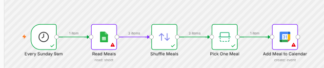

# Automated Weekly Meal Planner (n8n)

## Why I built this

I wanted a small, real project to learn n8n with — not a toy tutorial, something I'd actually use. Every Sunday I'm trying to figure out what to cook for the week, and I already had a list of meals I rotate through in my head. So instead of a "hello world" automation, I built something that solves an actual weekly annoyance: it picks a meal for me and puts it straight on my calendar.

## What it does

Every Sunday at 9am, the workflow:

1. Reads my list of go-to meals from a Google Sheet (21 meals, mostly South Indian home cooking — idli, dosa, biryani, that kind of thing — plus the grocery items for each one)
2. Shuffles the list and picks one at random
3. Adds it to my Google Calendar as a dinner event, 6–7pm

If a run ever fails — say my Google connection expires — I get an email telling me exactly which step broke and why, instead of silently missing a week.

## How it's built

Five nodes, no code:

- **Schedule Trigger** — fires every Sunday at 9am (Chicago time)
- **Read Meals** — pulls every row from my Meal Planner Google Sheet
- **Shuffle Meals** — randomizes the order of the list
- **Pick One Meal** — keeps just the first item after shuffling
- **Add Meal to Calendar** — creates the "Dinner: `<meal>`" event on my Google Calendar

There's a second, smaller workflow attached as an error handler: if the main workflow fails for any reason, it emails me the workflow name, which step broke, the error message, and a link to the failed run.

## What I'd change next

Right now it just picks *a* meal — it doesn't know what I ate last week, so in theory it could repeat the same dish two Sundays in a row. A natural next version would track history and avoid recent repeats, or weight the picks (e.g. don't suggest biryani two weeks running). I'm leaving it simple for now since the goal was learning n8n's core patterns — triggers, data nodes, and error workflows — not building something elaborate on day one.

## What this showed me about n8n

Coming from a background of writing Python/SQL pipelines by hand, the thing that stood out was how much of the "plumbing" — OAuth connections, scheduling, retry/error handling — n8n just gives you for free through its node UI. The actual logic here (read a sheet, shuffle, pick one) is maybe five lines of code if I wrote it myself — but getting it to run reliably on a schedule, authenticated against two separate Google services, with failure alerts, would normally take a fair bit of setup. Here it took about 20 minutes, most of which was approving OAuth popups.
